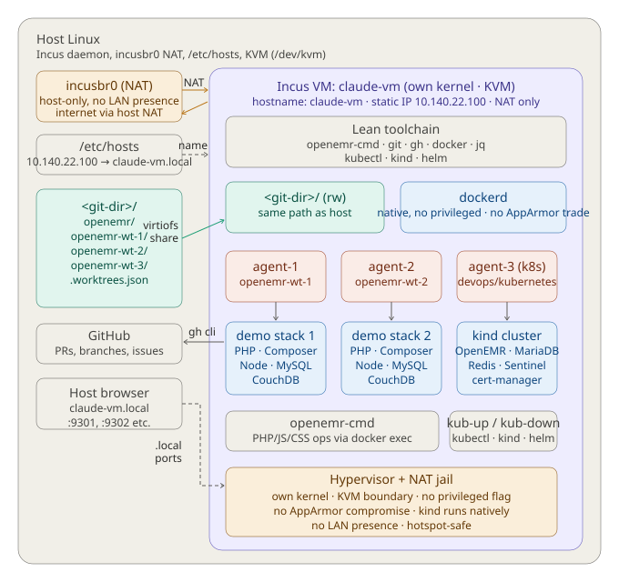

# Claude Code Multi-Agent Incus VM Appliance Setup

## Architecture



---

## Overview

A jailed Ubuntu VM running under Incus on the host Linux machine, connected to the host's git directory via a virtiofs share at the mirrored path. The VM uses Incus's default NAT bridge (`incusbr0`) rather than a separate LAN/host bridge, with a static IP assigned by Incus's host-side DHCP reservation and a single `/etc/hosts` entry on the host for name resolution.

This is a **sibling configuration** to the [LXC appliance](claude-appliance-setup.md), not a replacement. It targets the same workflow (one agent per worktree, each in its own Docker stack managed by `openemr-cmd`) with a different isolation posture: a hypervisor boundary between the agent and the host kernel, at the cost of a slower boot and virtiofs-speed metadata operations on the shared git path. Pick the configuration that matches your threat model and how often you boot the sandbox. Both can coexist on the same host — see [Coexistence with the LXC appliance](#coexistence-with-the-lxc-appliance).

**Key design decisions:**
- PHP, Composer, and Node for OpenEMR work are **not** installed in the VM — all PHP/JS/CSS work runs inside the demo stacks via `openemr-cmd` commands (`docker exec`). Node is installed only to run the agent CLI itself (Claude Code).
- The VM has its own kernel — Docker runs natively, with no privileged flag and no AppArmor compromise. The LXC appliance makes both trades to get nested Docker working; the VM does not need to.
- **NAT networking** (not bridged) — LAN hosts cannot initiate connections *to* the guest; the guest is invisible from outside the host. The guest can still reach the LAN *outbound* once forwarding is enabled — see threat model below.
- Static IP inside the guest + `/etc/hosts` on the host gives a stable `claude-vm.local` name — no mDNS or Avahi needed.
- Works on any connection including mobile hotspot — no dependency on LAN or router config.
- `openemr-cmd` handles all worktree lifecycle, port offset management, and Docker stack orchestration — identical workflow to the LXC appliance.
- **`kind` works** — the real guest kernel means the full `openemr-devops` Kubernetes dev-stack is runnable inside this appliance. The LXC appliance currently cannot run it ([documented in `openemr-devops`'s `kubernetes/README.md`](https://github.com/openemr/openemr-devops/blob/master/kubernetes/README.md)).

**Containment stack:**
- **Incus VM (KVM)** — the agent runs inside a guest with its own kernel. Container-style namespace jail *plus* a hypervisor boundary.
- **NAT networking** — jails inbound network access; the guest is not reachable from the LAN.
- **No OpenEMR dev tooling on appliance** — PHP, Composer, and project Node deps live only inside demo stacks.
- **virtiofs share of the host git directory** — the only intentional read-write bridge to the host.

---

## Threat model

Before changing anything below, understand what this appliance is and is not:

- **The VM is the trust boundary, not the user inside it.** The agent has effectively full privilege inside the guest (root via passwordless sudo, full capabilities for Docker, `--dangerously-skip-permissions` on Claude Code). That is intentional — the design treats the *whole appliance* as already-compromised and relies on the Incus VM + NAT to contain blast radius.
- **What is protected:** the host filesystem outside `<git-dir>`, the host Docker daemon, host localhost services, your LAN's inbound surface, and any GitHub/SSH credentials that live on the host but not in the guest.
- **What is *not* protected:** anything reachable from the virtiofs-shared `<git-dir>`, anything the guest can dial outbound (LAN included, unless you add egress firewall rules or an Incus ACL — see [Step 1](#step-1--configure-ufw-to-allow-incus-bridge-forwarding)), and the contents of any tokens/keys you place inside the guest (the GitHub PAT, the deploy key, the optional GPG key).
- **Defense in depth vs the LXC appliance.** The hypervisor boundary closes one specific path the LXC doc names up-front: a kernel-level escape from inside the LXC container lands on the host kernel directly, whereas here the same escape has to go through QEMU/KVM first. That is a real improvement — a categorically different trade. It is *not* the whole story: everything else in the threat model (shared `.git/` path, outbound LAN, credentials in the guest) is the same under either posture. Treat this as defense-in-depth on top of the containment the LXC appliance already provides, not as a replacement for the rest of the discipline.
- **The shared `.git/` in `<git-dir>/openemr/` is code-execution-relevant on the host.** Because the virtiofs share is writable by the agent, `.git/config` values (`core.sshCommand`, `core.hooksPath`, `credential.helper`, aliases, custom `filter` drivers), hook scripts under `.git/hooks/`, and directives in `.gitattributes` are all agent-writable. Any host-side git operation against this shared clone — `push`, `fetch`, `checkout`, commit (with or without signing) — can execute agent-planted code with your host credentials. This is the *main* host code-execution path the appliance threat model names, and virtiofs has the same surface as the LXC bind mount — the hypervisor boundary does not close it. For operations you want to insulate from this (typically: signed commits, or pushes to sensitive remotes from your host identity), use a separate host clone the agent cannot reach.
- **Posture:** treat the appliance as disposable. Snapshots are the rollback path. Do not put credentials in the guest that you would not be willing to revoke. Use a separate GitHub PAT, a per-repo deploy key, and (if you sign) a separate signing key — all documented below.
- **For stuff that must be strictly isolated from a compromised appliance** (such as personal finances), the honest answer is a physically separate machine — ideally powered off except when actively in use — not a tighter guest config on this host. As AI-agent autonomy grows, that separation-by-hardware pattern is likely to matter more.
- **If you want stricter outbound isolation,** two options: add host ufw rules dropping `incusbr0` traffic destined for RFC1918 ranges other than the loopback uplink (same shape as the LXC appliance's egress note), or use **Incus's native network ACLs** to express the same policy at the hypervisor — see the [Notes](#notes) section at the end. The default config below does neither.
- **New, small cost relative to the LXC appliance:** `incus-admin` group membership on the host is root-equivalent (anyone in that group can start a privileged guest and `incus file push` to arbitrary paths). Same shape as needing `sudo lxc-*` for the LXC appliance — call it out so it does not slip in.

---

## Step 1 — Configure ufw to allow Incus bridge forwarding

Incus guest networking requires packet forwarding through the `incusbr0` bridge. By default ufw blocks this. Prefer **scoped** route rules over flipping the global default forwarding policy — this keeps `DEFAULT_FORWARD_POLICY="DROP"` for every other interface (VPN tunnels, additional bridges, etc.) and only opens the path the guest actually needs.

First discover the subnet Incus picked at `incus admin init` (the installer below). Incus chooses a random RFC1918 `/24` for `incusbr0` on first init — it will not be `10.0.3.0/24` (that is `lxcbr0`), and it will not be the same across hosts. If you have not run `incus admin init` yet, come back to this step after Step 2.

```bash
# Replace <incus-subnet> below with the output of this command, e.g. 10.140.22.0/24
incus network get incusbr0 ipv4.address
# e.g. 10.140.22.1/24 — strip the host portion to get the subnet (10.140.22.0/24)
```

Then:

```bash
# Allow ufw-managed traffic to/from the incusbr0 bridge itself
sudo ufw allow in on incusbr0
sudo ufw allow out on incusbr0

# Allow routed/NAT forwarding for traffic to/from the incusbr0 subnet.
# We deliberately do not pin the *other* interface so this works regardless
# of which uplink is active (home wifi, ethernet dock, phone tether, mobile
# hotspot, etc.) — the design goal is "works on any connection."
sudo ufw route allow in on incusbr0 from <incus-subnet>
sudo ufw route allow out on incusbr0 to <incus-subnet>

sudo ufw reload
```

> **Why scope the rules to the subnet?** Without `from`/`to` the route rules would allow forwarding of any packet arriving on `incusbr0` regardless of source — fine on a single-user developer host, but needlessly permissive. Scoping to the actual Incus-assigned subnet matches the discipline used in the [LXC appliance guide](claude-appliance-setup.md#step-1--configure-ufw-to-allow-lxc-bridge-forwarding) and keeps the policy auditable.

> **If Docker is also running on the host,** Docker sets `FORWARD` to `DROP` in iptables on startup, which silently breaks `incusbr0` outbound regardless of the ufw rules above. Persist two rules via `iptables-persistent` (or ufw `before.rules`):
>
> ```bash
> sudo iptables -I DOCKER-USER -i incusbr0 -j ACCEPT
> sudo iptables -I DOCKER-USER -o incusbr0 -m conntrack --ctstate RELATED,ESTABLISHED -j ACCEPT
> ```
>
> This only matters if the *host* runs Docker. The Docker daemon inside the guest does not touch host iptables.

> **If you want stricter scoping** at the cost of network portability, pin the uplink as the LXC guide does. See [LXC Step 1](claude-appliance-setup.md#step-1--configure-ufw-to-allow-lxc-bridge-forwarding) — the shape is identical here, substituting `incusbr0` for `lxcbr0`.

---

## Step 2 — Install Incus on the host

Incus's packaging story depends on your distro:

| Distro                   | Source                                       |
|--------------------------|----------------------------------------------|
| Ubuntu 24.10+, Debian 12+ | Native apt repos (`sudo apt install incus`) |
| Ubuntu 24.04 LTS         | **Zabbly upstream apt repo** (steps below)   |
| Ubuntu 22.04 LTS         | Zabbly upstream apt repo                     |

[Zabbly](https://github.com/zabbly/incus) is maintained by Stéphane Graber (the Incus project lead) and is the canonical upstream source for Debian/Ubuntu Incus packages that are not yet in distro repos. On Ubuntu 24.04 LTS — the host the LXC appliance guide also targets — `apt install incus` fails with "Package 'incus' has no installation candidate" because Incus landed in Ubuntu universe only at 24.10.

**Ubuntu 24.04 LTS — add the Zabbly repo first:**

```bash
sudo mkdir -p /etc/apt/keyrings/
sudo wget -O /etc/apt/keyrings/zabbly.asc https://pkgs.zabbly.com/key.asc

# Verify the key fingerprint before trusting it. Compare against the fingerprint
# published at https://github.com/zabbly/incus#repository and in Stéphane Graber's
# announcement posts — treat the GitHub README as the source of truth, not this doc.
gpg --show-keys /etc/apt/keyrings/zabbly.asc

sudo sh -c 'cat > /etc/apt/sources.list.d/zabbly-incus-stable.sources <<EOF
Enabled: yes
Types: deb
URIs: https://pkgs.zabbly.com/incus/stable
Suites: $(. /etc/os-release && echo ${VERSION_CODENAME})
Components: main
Architectures: $(dpkg --print-architecture)
Signed-By: /etc/apt/keyrings/zabbly.asc
EOF'

sudo apt update
```

**Then install Incus (same step on all distros above):**

```bash
sudo apt install incus
sudo incus admin init    # accept defaults, except choose btrfs or zfs if offered — snapshots are instant on CoW storage pools
sudo usermod -aG incus-admin $USER
# log out / log back in so the new group membership takes effect
```

The `incus` package pulls `qemu-system-x86` and `virtiofsd` as dependencies — no need to install them explicitly.

> **`incus-admin` is root-equivalent on the host.** Membership lets any user start privileged guests and push files to arbitrary paths. The same shape as needing `sudo lxc-*` in the LXC guide — called out here so it does not slip in. See the threat model for the full posture.

Confirm `/dev/kvm` is present and usable (Incus VMs require it):

```bash
ls -l /dev/kvm
# crw-rw---- 1 root kvm ... /dev/kvm — if missing, the host doesn't have KVM enabled.
groups | grep -qw kvm || sudo usermod -aG kvm $USER   # log out/in again if added
```

Now that `incusbr0` exists, return to Step 1 and apply the ufw rules with the real subnet.

---

## Step 3 — Prepare the cloud-init file

> 💻 **On the host machine**

Create `claude-vm.yaml` in a working directory of your choice. The `$(id -u)` and `$(id -g)` expansions bake your host's UID/GID into the file so the agent's writes to the virtiofs share appear as *your* user on the host — not uid 1000, which may belong to someone else on a multi-user machine.

```bash
cat > claude-vm.yaml << YAML
#cloud-config
hostname: claude-vm
users:
  - name: claude-agent
    uid: $(id -u)
    shell: /bin/bash
    lock_passwd: true
    sudo: "ALL=(ALL) NOPASSWD: /usr/bin/apt-get, /usr/bin/systemctl"
packages:
  - git
  - curl
  - wget
  - gnupg
  - ca-certificates
  - jq
YAML
```

The heredoc expands `$(id -u)` on the host at write time, baking your host UID into the YAML. cloud-init auto-creates a same-named primary group at the next free GID (typically matching the UID on a fresh guest). If you need the GID to match your host GID exactly — rarely needed in practice — add a `runcmd:` block that calls `groupmod -g $(id -g) claude-agent && usermod -g claude-agent claude-agent` with your host GID baked in the same way.

> **Why no `default` user entry?** The Ubuntu cloud image's default cloud-init profile creates an `ubuntu` user at UID 1000. Omitting the `default` entry suppresses that user entirely, which keeps UID 1000 free for `claude-agent` when that is your host UID. The LXC appliance guide handles this by renaming `ubuntu` → `claude-agent` post-boot; cloud-init lets us skip that dance.

> **virtiofs passes UIDs through — Incus's uid shift is containers-only.** For LXC containers, Incus can shift container UIDs to a per-guest subrange on the host (e.g. container-root maps to host 1000000). That shift does not apply to VM disks over virtiofs: whatever uid writes a file *inside* the VM is the uid stamped on the file *on the host*. So the agent's `claude-agent` uid in the guest must match your host user's uid for shared git-dir operations to work cleanly. The `$(id -u)` expansion above is how we enforce that.

---

## Step 4 — Create the VM

> 💻 **On the host machine**

```bash
# Replace <git-dir> with your actual git base directory, e.g. /home/<your-username>/git
incus init images:ubuntu/24.04/cloud claude-vm --vm \
  -c limits.cpu=8 \
  -c limits.memory=16GiB \
  -d root,size=100GiB \
  -c cloud-init.user-data="$(cat claude-vm.yaml)"

# virtiofs share of the host git directory, at the mirrored path inside the guest.
# Path must match host-side exactly (no leading slash in the target: Incus adds it).
incus config device add claude-vm git disk source=<git-dir> path=<git-dir>
```

> **Sizing.** 16 GiB RAM and 8 vCPUs is a sensible starting point for a few parallel worktrees plus a small `kind` cluster. Scale down if you only ever run one stack at a time; scale up before expecting the full `openemr-devops` Kubernetes dev-stack to behave. Unlike the LXC appliance, these resources are dedicated to the guest while it is running — they do not float back to the host under load.

> **Boot time.** First boot takes ~30-60s while cloud-init runs (user creation, apt install for the base packages). Subsequent boots are ~10-20s. The LXC appliance is ~1s by comparison. Factor this into your "start a session" workflow.

---

## Step 5 — Set a static IP via host-side DHCP reservation

> 💻 **On the host machine**

The LXC guide configures a static IP from *inside* the guest via systemd-networkd. Incus has a cleaner mechanism: a host-side DHCP reservation. Nothing to configure inside the guest.

```bash
# Discover the subnet Incus assigned to incusbr0
incus network get incusbr0 ipv4.address
# e.g. 10.140.22.1/24 — use any unused address in that subnet for the reservation
#     (avoid .1 which is the bridge itself, and avoid conflicts if you ever add
#     a second guest). .100 is a safe convention matching the LXC guide.

# Reserve the IP. Replace 10.140.22.100 with your chosen address in the subnet above.
incus config device override claude-vm eth0 ipv4.address=10.140.22.100
```

---

## Step 6 — Start the VM

> 💻 **On the host machine**

```bash
incus start claude-vm
incus list claude-vm     # wait until STATUS is RUNNING and an IPv4 address is listed
```

First boot finishes when cloud-init is done; on a cold start this can take ~30-60s. Watch cloud-init progress if you want:

```bash
incus exec claude-vm -- cloud-init status --wait
# Eventually prints: status: done
```

Enter the guest as root for the remaining toolchain install:

```bash
incus exec claude-vm -- bash
```

---

## Step 7 — Install the lean toolchain

> 🖥️ **Inside guest** (as root, via `incus exec claude-vm -- bash`)

This is the same toolchain the LXC appliance installs; cloud-init handled the base packages (git, curl, wget, gnupg, ca-certificates, jq) in Step 3, so this step skips those.

```bash
# GitHub CLI
curl -fsSL https://cli.github.com/packages/githubcli-archive-keyring.gpg \
  | dd of=/usr/share/keyrings/githubcli-archive-keyring.gpg
echo "deb [signed-by=/usr/share/keyrings/githubcli-archive-keyring.gpg] \
  https://cli.github.com/packages stable main" \
  > /etc/apt/sources.list.d/github-cli.list
apt update && apt install -y gh

# Docker (full daemon — the VM boundary is the jail, no nested-Docker tricks needed)
curl -fsSL https://get.docker.com | sh
systemctl enable docker
systemctl start docker

# kubectl
# Note: this fetches the current stable release. Pin to a specific version
# and verify the published .sha256 file if you want stricter supply-chain guarantees.
curl -fsSL https://dl.k8s.io/release/$(curl -fsSL https://dl.k8s.io/release/stable.txt)/bin/linux/amd64/kubectl \
  -o /usr/local/bin/kubectl
chmod +x /usr/local/bin/kubectl

# kind (Kubernetes IN Docker — works natively here; see openemr-devops/kubernetes/)
# Note: this fetches the latest release. Pin to a specific version and verify the
# SHA from https://github.com/kubernetes-sigs/kind/releases for stricter supply-chain guarantees.
curl -fsSL https://kind.sigs.k8s.io/dl/latest/kind-linux-amd64 \
  -o /usr/local/bin/kind
chmod +x /usr/local/bin/kind

# helm (used by kub-up to install cert-manager and NFS provisioner)
# Note: piping a remote install script to a shell is convenient but trusts the upstream;
# pin a specific Helm release if you want stricter supply-chain guarantees.
curl -fsSL https://raw.githubusercontent.com/helm/helm/main/scripts/get-helm-3 | bash

# openemr-cmd (clone openemr-devops into the shared git dir if not already present)
if [ ! -d "<git-dir>/openemr-devops" ]; then
  git clone https://github.com/openemr/openemr-devops.git <git-dir>/openemr-devops
fi
cp <git-dir>/openemr-devops/utilities/openemr-cmd/openemr-cmd /usr/local/bin/openemr-cmd
chmod +x /usr/local/bin/openemr-cmd

# Add claude-agent to docker group
usermod -aG docker claude-agent

# Node.js and Claude Code
curl -fsSL https://deb.nodesource.com/setup_lts.x | bash -
apt install -y nodejs
npm install -g @anthropic-ai/claude-code

# No PHP, Composer, or Avahi — not needed
```

---

## Step 8 — Add name resolution on the host

> 💻 **On the host machine**

```bash
sudo nano /etc/hosts
```

Add (using the IP you reserved in Step 5):

```
10.140.22.100   claude-vm.local
```

Verify from the host:

```bash
ping claude-vm.local
# Should get replies from the reserved IP
```

> **Distinct name from the LXC appliance.** If you also run the LXC appliance on this host, it uses `claude-appliance.local`. The VM uses `claude-vm.local`. The two `/etc/hosts` entries can coexist; see [Coexistence with the LXC appliance](#coexistence-with-the-lxc-appliance).

---

## Step 9 — Authenticate GitHub CLI

> 🖥️ **Inside guest** (as claude-agent)

The LXC appliance's [Step 10](claude-appliance-setup.md#step-10--authenticate-github-cli) applies identically. In short: generate a fine-grained personal access token scoped to the minimum permissions, with 90-day expiration, and authenticate inside the guest:

```bash
incus exec claude-vm -- su - claude-agent
gh auth login
# Select: GitHub.com → HTTPS → Paste token
```

Required permissions:

| Permission | Level |
|------------|-------|
| Metadata | Read (always required) |
| Pull requests | Read and write |
| Issues | Read and write |

> `Contents` is **not** needed — agents push branches via `git push` using the existing repo remote (SSH deploy key), not via the token. The token is only used by `gh` CLI for API operations (opening PRs, reading issues).

---

## Step 9a — Deploy key for fork pushes

> 🖥️ **Inside guest** (as claude-agent)

Identical to the LXC appliance's [Step 10a](claude-appliance-setup.md#step-10a--deploy-key-for-fork-pushes) — generate a per-repo SSH deploy key, register it with "Allow write access" on your fork, configure a repo-scoped `Host` alias in `~/.ssh/config`, rewrite origin to use it, and mirror the alias on the host side. The mechanism is unchanged in the VM.

Verify:

```bash
ssh -T git@github-<your-username>-openemr
# Expected: "Hi <your-username>/openemr! You've successfully authenticated,
#            but GitHub does not provide shell access."
```

The greeting naming the **repo** (not your username) confirms the key is repo-scoped.

> **Host-side alias mirror.** Because `<git-dir>` is shared via virtiofs, the rewritten origin URL (`git@github-<your-username>-openemr:...`) is visible from the host too. Follow the LXC guide's host-side `~/.ssh/config` stanza to point the host at *your* regular SSH key for that alias. See the inset in [LXC Step 10a](claude-appliance-setup.md#step-10a--deploy-key-for-fork-pushes).

---

## Step 9b — Optional: GPG signing inside the guest

> 🖥️ **Inside guest** (as claude-agent)

Identical to the LXC appliance's [Step 10b](claude-appliance-setup.md#step-10b--optional-gpg-signing-inside-the-container). All the same tradeoffs apply: attestation blurs on GitHub, so use a dedicated signing key for the appliance; generate it in batch (loopback) mode because interactive pinentry fails under `incus exec … -- su -`.

```bash
gpg --batch --pinentry-mode loopback --passphrase "" \
  --quick-generate-key 'Your Name (claude-vm) <your@email.com>' \
  default sign 1y
```

The remainder (list keys, export public half, paste into GitHub, configure git) is unchanged. See the LXC guide for the full walkthrough.

---

## Step 10 — Verify git path and worktree resolution

> 🖥️ **Inside guest** (as claude-agent)

```bash
ls <git-dir>/
# Should see: openemr  plus zero or more openemr-wt-<branch-slug> directories
# (openemr-cmd derives the slug from the branch name — e.g. branch
# "feature/foo" becomes directory openemr-wt-feature-foo).

openemr-cmd worktree list
# Shows all worktrees, ports, and status. Pick one of the listed
# directories for the cd test below (skip if no worktrees yet).

# cd <git-dir>/openemr-wt-<branch-slug>
# git status
# Should work — .git pointer resolves to <git-dir>/openemr/.git
```

> **If `git status` is noticeably slower than on the host,** that is the virtiofs metadata-op cost — the main performance difference from the LXC appliance. It is felt on commands that `stat` a large directory tree (`git status`, large `find`, recursive `ls`). The hot paths OpenEMR actually cares about — `composer install`, `npm install`, `vendor/`, `node_modules` — stay off the share because `openemr-cmd`'s stacks keep them in Docker *volumes* (inside the guest's own disk), not on the bind mount. See the [Notes](#notes) section for more.

---

## Step 11 — Verify demo stack and port access from host

> 🖥️ **Inside guest** (as claude-agent)

```bash
cd <git-dir>/openemr

# Create test worktree and start stack
openemr-cmd worktree add test-vm -b --env easy --start

# Check assigned ports
openemr-cmd worktree list

# Verify PHP tooling runs inside the stack, not the appliance
openemr-cmd pp
openemr-cmd ut
```

> 💻 **On the host** — open a browser and visit the HTTPS URL for `test-vm` using its assigned port from `openemr-cmd worktree list`. For offset 1, use:

```
https://claude-vm.local:9301
```

Click through the SSL warning (self-signed cert — connection is still encrypted). You should see the OpenEMR setup/login screen.

> 🖥️ **Inside guest** — fully remove the test worktree (one-time human-run setup verification, not an agent action):

```bash
echo "y" | openemr-cmd worktree remove test-vm
```

> **Why `remove` here and not `down`?** Same rationale as the LXC guide — `worktree remove` deletes the ~10 branch-scoped named volumes `openemr-cmd` creates per worktree. See [LXC Step 12](claude-appliance-setup.md#step-12--verify-demo-stack-and-port-access-from-host) for the full breakdown. `AGENTS.md` instructs *agents* never to run `worktree remove`; this step is run by you, the human setting up the appliance.

---

## Step 12 — Snapshot the baseline

> 💻 **On the host**

Incus snapshots are nearly instant on btrfs/zfs storage pools. Stop the guest cleanly first:

```bash
incus stop claude-vm
incus snapshot create claude-vm baseline
incus snapshot list claude-vm
incus start claude-vm
```

To restore if something goes wrong later:

```bash
incus stop claude-vm
incus snapshot restore claude-vm baseline
incus start claude-vm
```

> **Note:** The virtiofs-shared `<git-dir>` is not included in snapshots — it lives on the host. Snapshots protect the guest configuration and rootfs only, same as the LXC appliance.

---

## Step 13 — Day-to-day use

The setup above only runs once. After that, launching an agent session is:

1. **Start the guest** (skip if already running):

   > 💻 **On the host**
   ```bash
   incus start claude-vm
   ```

2. **Enter the guest as the agent user** (no `sudo` needed — `incus-admin` group handles authorization):

   > 💻 **On the host**
   ```bash
   incus exec claude-vm -- su - claude-agent
   ```

3. **Go to the openemr checkout and launch Claude Code:**

   > 🖥️ **Inside guest** (as claude-agent)
   ```bash
   cd <git-dir>/openemr
   claude --dangerously-skip-permissions
   ```

That's it — go to town.

### Running multiple sessions in parallel

Open a second terminal on the host, repeat steps 2 and 3 there. Each session just needs to drive its worktrees via `openemr-cmd worktree` per the rules in [`AGENTS.md`](../../AGENTS.md). `openemr-cmd` assigns each worktree a distinct port offset and namespaces its Docker volumes, so parallel stacks do not collide.

> **Why `--dangerously-skip-permissions` is acceptable here.** Claude Code's per-action permission prompts are the guardrail for agents running directly on your host. Inside this appliance the Incus VM + NAT boundary is the security model — see the [threat model](#threat-model) section at the top for what that does and does not protect. Outside this context, leave the prompts on.

---

## Service quick reference

Full port-derivation formulas (any offset) live in [`AGENTS.md`](../../AGENTS.md#working-in-a-git-worktree). This table shows the offset-1/2/3 examples for the services `openemr-cmd` brings up on each worktree:

| Service | Worktree 1 | Worktree 2 | Worktree 3 |
|---------|-----------|-----------|-----------|
| OpenEMR HTTPS | `https://claude-vm.local:9301` | `:9302` | `:9303` |
| OpenEMR HTTP | `http://claude-vm.local:8301` | `:8302` | `:8303` |
| phpMyAdmin | `http://claude-vm.local:8311` | `:8312` | `:8313` |
| MySQL | `claude-vm.local:8321` | `:8322` | `:8323` |
| Mailpit | `http://claude-vm.local:8026` | `:8027` | `:8028` |
| CouchDB | `http://claude-vm.local:5985` | `:5986` | `:5987` |
| Selenium (WebDriver) | `http://claude-vm.local:4445/wd/hub` | `:4446/wd/hub` | `:4447/wd/hub` |
| Redis | `claude-vm.local:6380` | `:6381` | `:6382` |

> SSL warning on OpenEMR HTTPS is expected — the dev stack uses a self-signed cert. The connection is still encrypted. Click through once; Firefox lets you add a permanent exception.

---

## Coexistence with the LXC appliance

The LXC appliance and the Incus VM appliance can run on the same host simultaneously. There is nothing to coordinate at the kernel level (different hypervisor subsystem, different bridge, different NAT), but a few names and paths must stay distinct and a few shared resources need to be reasoned about:

- **Hostnames and `/etc/hosts` entries are distinct.** LXC uses `claude-appliance.local`; VM uses `claude-vm.local`. Both entries coexist in `/etc/hosts`.
- **Subnets are distinct by default.** `lxcbr0` is `10.0.3.0/24`; Incus picks a random RFC1918 `/24` for `incusbr0` at `incus admin init`.
- **The virtiofs share and the LXC bind mount point at the same host directory.** This is intentional — both appliances work against the same git-dir on the host, which is also where you edit from the host.
- **`openemr-cmd`'s state file is shared.** `.worktrees.json` lives in `<git-dir>/openemr/` (the primary repo root), on the shared surface both appliances see. Offset allocation is therefore coordinated across appliances — each worktree gets a single distinct offset regardless of which appliance registered it, and `openemr-cmd worktree list` from either appliance shows the same set of entries.
- **Docker daemons are *not* shared.** Each appliance has its own `dockerd` inside its own guest. A worktree's Docker stack lives in exactly one appliance — whichever one ran `worktree add` or `worktree up`. The other appliance can see the state entry but cannot `exec`/`stop` the stack. Don't `worktree remove` from the appliance that is not running the stack — the state entry gets deleted but the stack is orphaned in the other guest's `dockerd` with no way to clean it up through `openemr-cmd`.
- **Ports do not collide.** Each guest's Docker stacks bind to that guest's own IP, not to the host's loopback. `claude-appliance.local:9301` and `claude-vm.local:9301` are different endpoints even though they share the port number, because the two `.local` names resolve to different guest IPs.
- **Choose one appliance as "primary" per worktree.** In practice: use the LXC appliance for day-to-day work (fast boot, bind-mount I/O speed) and spin up the VM when you specifically need the Kubernetes dev-stack or the stronger isolation. Keep worktrees pinned to the appliance that created them to avoid the orphan-stack trap above.
- **Host firewall rules do not conflict.** The Step 1 ufw rules reference `incusbr0` by name and the LXC guide's rules reference `lxcbr0` — separate interface names, separate rules, no overlap.

---

## Notes

### Performance expectations vs the LXC appliance

| Axis | LXC appliance | Incus VM appliance |
|---|---|---|
| Cold boot | ~1 s | ~10-20 s (first boot ~30-60 s while cloud-init runs) |
| Shared git-dir I/O | Host-speed bind mount | virtiofs — host-speed read/write for *data*, slower for metadata ops (`stat`, large `ls`, `git status` across many files) |
| Docker image I/O | On a path under LXC rootfs | On the guest's own virtual disk — dedicated, fast |
| Compiled/installed deps (`vendor/`, `node_modules`) | In Docker volumes inside the stack | In Docker volumes inside the stack (same) |
| RAM footprint | Shared with host, pay only for processes running | Dedicated to guest while running (16 GiB in the example) |

The main day-to-day friction compared to the LXC appliance is boot time and `git status` latency on large trees. Neither is prohibitive.

### Stricter outbound isolation via Incus network ACLs

Incus has a native network ACL mechanism that expresses "deny egress to RFC1918 except the gateway" more cleanly than host ufw/iptables rules do. Sketch:

```bash
# Create an ACL that denies egress to private ranges (RFC1918 + loopback aliases),
# then allow everything else
incus network acl create agent-egress
incus network acl rule add agent-egress egress \
  action=reject destination=10.0.0.0/8 description="deny RFC1918 10/8"
incus network acl rule add agent-egress egress \
  action=reject destination=172.16.0.0/12 description="deny RFC1918 172.16/12"
incus network acl rule add agent-egress egress \
  action=reject destination=192.168.0.0/16 description="deny RFC1918 192.168/16"
incus network set incusbr0 security.acls=agent-egress
```

Not applied in the default configuration above because many developer workflows (reaching a local registry, a company intranet behind VPN, a self-hosted LDAP for test-data) deliberately *want* RFC1918 access from the guest. If you are confident the guest only ever needs the public internet, this is the tightest expression of that policy.

### Non-Incus hypervisors

The design — a cloud-init-driven Ubuntu guest with a virtiofs share of `<git-dir>`, NAT networking, and a static IP pinned by host-side DHCP — is not Incus-specific. Equivalents exist in:

- **libvirt** (`virt-install`, `virsh`) — more moving parts, but same shape; virtiofs requires a recent libvirt + qemu.
- **Multipass** — Canonical's Ubuntu-focused tool; simpler to install, fewer knobs, no first-class virtiofs.
- **Lima** — the natural pick for macOS hosts. First-class virtiofs, cloud-init-driven, and the full workflow translates. If you are on macOS and want this appliance, that is the direction to look; a dedicated Lima guide is a reasonable followup if someone picks it up.

Incus is the easiest path on Linux because the `incus`/`incusbr0`/`cloud-init.user-data` pieces compose cleanly and because snapshots on btrfs/zfs are instant. The security posture (defense-in-depth on top of VM isolation) is the hypervisor's, not Incus's — any of the above gives you the same boundary.
